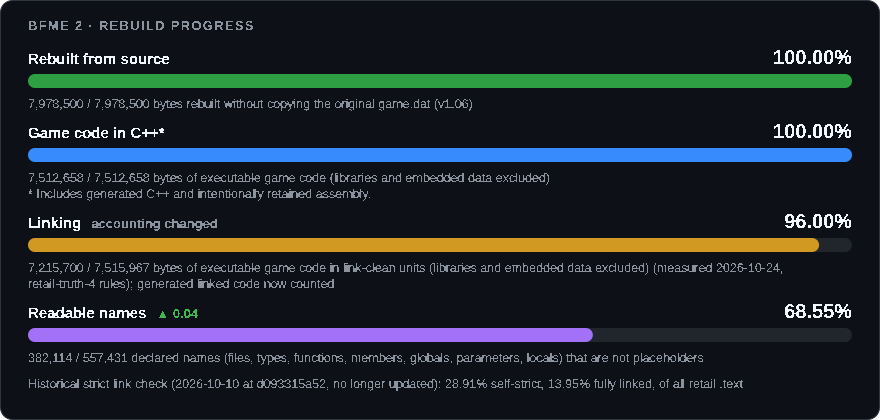
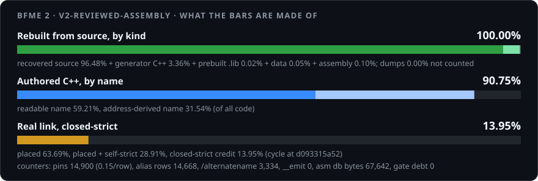
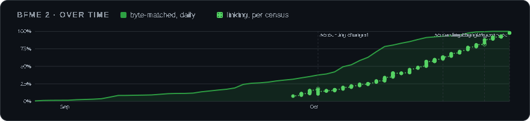
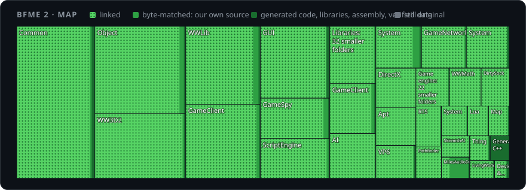

# BFME 2 Source Code

Goal: Source code that rebuilds BFME 2's engine binary (`game.dat`) byte-for-byte, and game modernization improvements that you've only seen in your dreams.

[Join our Discord to participate!](https://discord.gg/wCvA2XqPUT)

## What?

* We rewrote the game's code one small piece at a time, and each piece turns back into the exact same bytes as the original game.dat (BFME 2, version 1.06). That stage, byte matching, is complete.
* The work now (Phase 2) is making those pieces link into one program: closing the symbols the whole-program link still has to stub, merging the one-function files back into the source files the original was built from, giving every class one header, retiring recorded debt, and replacing generated and placeholder code with real C++ and real names.
* The goal is a game that links with no stubs and no `/FORCE`, boots to the menu, plays a skirmish and saves and loads. Then the whole game is open source, and we can fix bugs and make mods.

[](tools/progress.py)

[](tools/progress_v2.py)

### What the bars measure

* **Rebuilt from source**: code rebuilding to the original game.dat's exact bytes, including generated code, attached prebuilt libraries, verified data in `.text`, and explicitly reviewed reconstructed assembly (the clean-room MMX IDCT family, documented register/stack runtime entries and the patched-target signature check). Retail dumps remain excluded.
* **Game code in C++\***: the asterisk matters. The bar counts authored C++, generated C++ *and* intentionally retained reviewed assembly, over executable game code (libraries and embedded data excluded), so 100% does not mean the game is all hand-written C++. The footnote on the card gives the three parts separately (authored C++, generated C++, reviewed assembly); `python3 tools/progress.py` prints the full breakdown.
* **Linking**: executable game code in files that link cleanly, including generated C++ and reviewed assembly assessed by the census. Libraries and embedded data are excluded from both sides. Assembly without a recorded assessment receives no credit. Both totals use the same census tree; historical authored-only totals remain available. Each file is judged on its own: its names resolve, with no duplicate or wrong copy.
* **Strict link check** (the line under the bars): the whole tree linked at the original game's addresses with every reference checked ([`tools/link_cycle.py`](tools/link_cycle.py)). *Self-strict* is code placed at its original address whose own references land where the original's do; *fully linked* also needs everything it reaches to be right, so it waits on code nobody has converted yet. Both are shares of the original's whole code section, libraries included (the Linking bar counts only the game's own code). **The line on the card is historical**: it comes from the last receipt committed to this repository, measured on 2026-10-10 (date and commit shown on the card; the rules-v2 card's "Real link, closed-strict" row is the same receipt), and receipts are no longer committed. Newer measurements are to be published as link-cycle bundles ([`tools/cycle_artifacts.py`](tools/cycle_artifacts.py)); none has been published yet.
* **Readable names**: declared names that are not placeholders (files, types, functions, members, globals, parameters and locals); not proof of original EA names. Its daily change compares the displayed percentages in percentage points; `· 0.00` means unchanged. The first post has no comparison.

<details open>
<summary><b>Progress over time and code map</b></summary>

[Interactive report](https://open-bfme.github.io/Open-BFME-2/)





</details>

## Status

Byte matching of `.text` is complete (`python3 tools/progress.py`: BYTE-MATCHED
100%). Phase 2, linking and cleanup, is the open work; its exit test is in
[`docs/verifier_upgrade_plan.md`](docs/verifier_upgrade_plan.md) (step 12). Where
it stood on 2026-10-25:

* the census's Linking figure is the bar above; the whole-program link at retail
  addresses still needed 1,810 stub symbols (a local link cycle of that day; no
  bundle with the stub list is published yet);
* about 23,300 source files under `Code/`, mostly one function each, against the
  few hundred translation units retail was built from; 15,529 of the 91,361
  rows in `reverse/tu_map.csv` are approved for a translation unit and 22,045
  are only proposed.

`python3 tools/next_work.py --claim` serves this work: gate debt first, then link
repair, stub closure, class headers, translation-unit approval and merges, data
and code identity, Microsoft-header and DirectX migration, each by a stated
share (`TIER_WEIGHTS` in `tools/next_work.py`).

## Roadmap

* [ ] BFME 2 Source Code
* [ ] 60/120 FPS
* [ ] Memory fix
* [ ] Better crash logs
* [ ] Multi CPU
* [ ] World builder Source Code
* [ ] Bigger maps
* [ ] RotWK support

Off-host delay is already fixed by the community (BFME 2 patch 1.09v3, RotWK 2.02 v9), so it is deliberately not on this roadmap.

## How You Can Help

Clone the repo and give your AI agent this prompt:

> Read AGENTS.md and follow it. Loop: run `python3 tools/next_work.py --claim`,
> work the served item (and the rest of its file) until its pass test passes,
> verify with `./build.sh`, and commit each verified change on its own. Make a
> PR when you have a few landed changes.

Byte matching is finished, so "convert a body to byte-exact C++" is no longer the
usual task: the picker serves Phase 2 work (see Status). Each commit in the PR is
one verified change, and I will be able to land it.

!! All such AI-generated PRs are appreciated !!

## Build

The baseline executables are committed directly; the MSVC 7.1 toolchain and the
Zero Hour reference source live in the Open-BFME-1 submodule, so clone with
submodules:

```bash
git clone --recurse-submodules https://github.com/Open-BFME/Open-BFME-2.git
cd Open-BFME-2
./tools/setup_hooks.sh   # enable the pre-commit byte-check (git won't do this from a clone)
./build.sh               # verify every tracked function against retail   (.\build.ps1 on Windows)
```

Units marked `// dxsdk` compile against the DirectX 9.0c SDK (August 2005), vendored in `vendor/dxsdk-aug2005/` (see its `PROVENANCE.txt`).

`setup_hooks.sh` also registers `tools/merge_rows.py` as the merge driver for the
ledgers in `reverse/`, so a rebase does not bring back rows the other side deleted
or edited. A clone that skipped it gets the driver on its first commit attempt that
reaches the pre-commit hook, if the hook can write `.git/config` (it makes three
attempts, then leaves it for a later commit). A clone that only pulls keeps git's
built-in union merge, unless it is a linked worktree: worktrees share one config, so
one registers for all. A worktree older than the driver then merges ledgers as
built-in union did, which needs `git merge-file --diff-algorithm` (git 2.44 or newer);
with an older git that merge stops on a conflict. To check:
`git config --get merge.union.driver` prints a command naming `tools/merge_rows.py`,
or nothing if the driver is not registered.

To check a single function while iterating, pass its file or name — a few seconds instead of the full run:

```bash
./build.sh Code/Libraries/Source/Compression/ZLib/trees.c
```
